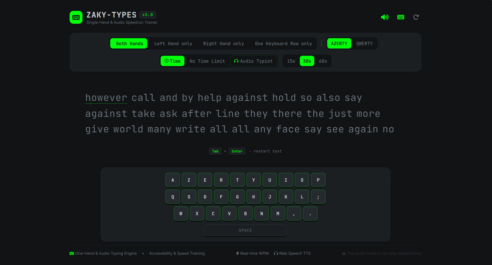
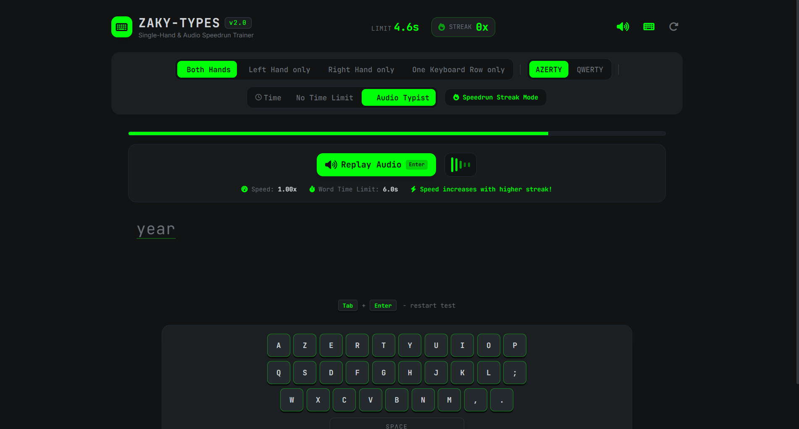

# ZAKY-TYPES

ZakyTypes is a browser-based typing trainer focused on one-handed typing practice and audio typing challenges.

## Features

- One-handed or two-handed typing practice
- QWERTY and AZERTY keyboard layouts
- Time-based and word-count typing tests
- Audio Typist mode with spoken words and progressive speed difficulty
- Live WPM, accuracy, timing, and streak feedback
- Optional visual keyboard and typing sounds
- Dark gray interface with bright green accents

## Getting started

No build step is required. Open [monkeytype_one_hand_trainer.html](./monkeytype_one_hand_trainer.html) in a modern browser.

The page loads fonts, icons, and Tailwind CSS from external CDNs, so an internet connection may be needed for the complete visual experience.

## How to use

1. Select a hand and keyboard layout.
2. Choose **Time**, **Words**, or **Audio Typist** mode.
3. Click the typing area or press a key to focus the test.
4. Use **Esc** or the restart button to start a new test.
5. In Audio Typist mode, use **Ctrl** or the replay button to hear the current word again.

## Screenshots







## Project structure

```text
TypingSite/
├── monkeytype_one_hand_trainer.html
└── README.md
```
